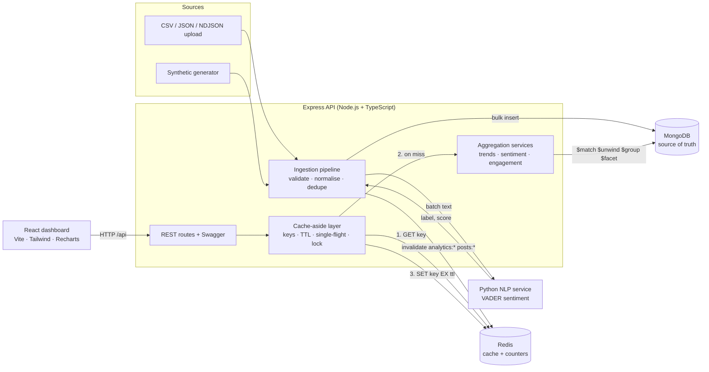

# SocialPulse AI

**Social media trend analytics using MongoDB, with Redis caching.**

SocialPulse ingests heterogeneous social-media posts from CSV, JSON or a synthetic generator. A Python NLP service scores each post's sentiment. Everything is stored as flexible MongoDB documents. Trends, sentiment and engagement are computed with MongoDB aggregation pipelines, and an Express REST API serves the results behind a Redis cache-aside layer to a React dashboard.

> **Data notice:** the bundled dataset and sample files are **synthetic**. They are generated by `backend/src/ingestion/synthetic.ts` and are not real social-media data. Every synthetic post is stored with `source.synthetic = true`, has a `syn…`/`sample…` id, and the dashboard labels it as synthetic.

---

## Contents

1. [Architecture](#architecture)
2. [Technology stack](#technology-stack)
3. [MongoDB vs Redis responsibilities](#mongodb-vs-redis-responsibilities)
4. [Quick start (Docker Compose)](#quick-start-docker-compose)
5. [Local development](#local-development)
6. [Environment variables](#environment-variables)
7. [MongoDB Atlas](#mongodb-atlas)
8. [Data ingestion](#data-ingestion)
9. [Database schemas and indexes](#database-schemas-and-indexes)
10. [Analytics (aggregation pipelines)](#analytics-aggregation-pipelines)
11. [Redis keys, TTLs and invalidation](#redis-keys-ttls-and-invalidation)
12. [API endpoints](#api-endpoints)
13. [Testing](#testing)
14. [Performance benchmark](#performance-benchmark)
15. [Demo script for the review](#demo-script-for-the-review)
16. [Troubleshooting](#troubleshooting)
17. [Known limitations](#known-limitations)

---

## Architecture



The request path for an analytics call (cache-aside):

1. The route validates query parameters (Zod) into normalised filters.
2. A deterministic key is built: `<prefix>:cache:v1:<namespace>:sha1(canonical params)`. Canonicalisation sorts keys and array values and drops empty values, so `?platform=twitter,instagram&window=7d` and `?window=7d&platform=instagram,twitter` share one key.
3. `GET` from Redis. On a **hit**, return the result (`X-Cache: HIT`).
4. On a **miss**, run the MongoDB aggregation, `SET key value EX ttl`, and return it (`X-Cache: MISS`).
5. If Redis is unreachable or a command times out (500 ms), MongoDB serves the request (`X-Cache: BYPASS`).

Every response body carries `meta.cache` (status, key, TTL, Redis lookup ms, total ms). The dashboard shows this as a badge on every panel.

Repository layout:

```
backend/        Express + TypeScript API, ingestion, aggregation, cache, benchmark CLI, tests
nlp-service/    Python NLP module + HTTP service (VADER), pytest tests
frontend/       React + Vite + Tailwind + Recharts dashboard, Vitest tests
sample-data/    SYNTHETIC upload samples (CSV, JSON, deliberately invalid JSON)
docs/benchmarks Benchmark report (REPORT.md) and raw results (latest.json)
scripts/        End-to-end smoke test
docker-compose.yml, .env.example
```

## Technology stack

| Layer | Technology |
|---|---|
| Frontend | React 19, Vite 8, TypeScript, Tailwind CSS 4, Recharts 3, TanStack Query, React Router |
| Backend | Node.js 22, Express 5, TypeScript, Mongoose 8, node-redis 5, Zod, Multer, Pino, Helmet, express-rate-limit, Swagger UI |
| NLP | Python 3.12, vaderSentiment 3.3.2, standard-library HTTP server |
| Database | MongoDB 7 (local Docker) or MongoDB Atlas |
| Cache | Redis 7.4 (`allkeys-lru`, 256 MB, no persistence) |
| Testing | Vitest + Supertest (backend), Vitest + Testing Library (frontend), pytest (NLP), shell smoke test |
| Infrastructure | Docker Compose with health checks, nginx for the built frontend |

## MongoDB vs Redis responsibilities

| | MongoDB | Redis |
|---|---|---|
| Role | **Primary, permanent source of truth** | **Temporary, derived data only** |
| Stores | posts, users, hashtags, comments, engagement_metrics, sentiment_results, trends, ingestion_batches, benchmark_runs | Serialised analytics responses (with TTL), distributed locks, hit/miss counters, a per-minute timeline, the recent-invalidation log |
| Survives restart | Yes (named Docker volume `mongo-data`) | No (persistence disabled on purpose) |
| If unavailable | Answers already cached in Redis are still served (`HIT`); uncached queries and ingestion fail fast with HTTP 503; health reports `down` | API keeps working from MongoDB (`BYPASS`); health reports `degraded` |
| Consistency | Writes happen here first | Invalidated after every ingestion that changes data; TTL bounds staleness |

## Quick start (Docker Compose)

> Step-by-step Mac guide with `mongosh` and `redis-cli` inspection commands: [docs/LOCAL_DEMO.md](docs/LOCAL_DEMO.md).

Requirements: Docker Desktop (or Docker Engine with Compose v2).

```bash
cp .env.example .env
```

Edit `.env` and set `ADMIN_API_KEY` to a long random value, for example the output of `openssl rand -hex 24`. Then build and start everything:

```bash
docker compose up -d --build
```

| URL | What |
|---|---|
| http://localhost:8080 | Dashboard (nginx serves the built React app and proxies `/api`) |
| http://localhost:4000/api/docs | Swagger UI |
| http://localhost:4000/api/health | Health of MongoDB, Redis and NLP |

Load data in one of three ways:

- **Dashboard:** open **Data ingestion**, paste the admin key, then **Generate & ingest** (or upload `sample-data/sample-posts.csv`).
- **API:**

```bash
curl -X POST http://localhost:4000/api/ingestion/seed -H "X-API-Key: $(grep ^ADMIN_API_KEY .env | cut -d= -f2)" -H "Content-Type: application/json" -d '{"count":5000,"reset":true}'
```

- **CLI** (requires the local development setup below):

```bash
npm --prefix backend run seed -- --count 5000 --reset true
```

Run the acceptance smoke test (it seeds 200 more synthetic posts):

```bash
scripts/smoke-test.sh
```

Stop the stack. Add `-v` to also delete the MongoDB volume.

```bash
docker compose down
```

## Local development

Requirements: Node.js ≥ 20.19 (developed on 22.14), Python ≥ 3.10, Docker for MongoDB and Redis.

Start the infrastructure (MongoDB, Redis, NLP service) in Docker:

```bash
docker compose up -d mongo redis nlp
```

Backend (http://localhost:4000, reads the repository-root `.env`):

```bash
cd backend && npm ci && npm run dev
```

Frontend (http://localhost:5173, proxies `/api` to :4000):

```bash
cd frontend && npm ci && npm run dev
```

Optional: run the NLP service without Docker.

```bash
cd nlp-service && python3 -m venv .venv && .venv/bin/pip install -r requirements-dev.txt && .venv/bin/python -m socialpulse_nlp.server
```

## Environment variables

All variables live in `.env` (copy from `.env.example`). `.env` is git-ignored, and secrets are never committed.

| Variable | Default | Purpose |
|---|---|---|
| `MONGODB_URI` | `mongodb://localhost:27017/socialpulse` | MongoDB connection for local runs (Atlas URI supported) |
| `MONGODB_URI_DOCKER` | *(unset → `mongodb://mongo:27017/socialpulse`)* | Overrides the URI used by the backend container, e.g. for Atlas |
| `REDIS_URL` | `redis://localhost:6379` | Redis connection |
| `REDIS_KEY_PREFIX` | `sp` | Namespace for every key (tests use `sp:test:<random>`) |
| `REDIS_COMMAND_TIMEOUT_MS` | `500` | Per-command timeout before falling back to MongoDB |
| `CACHE_TTL_TRENDS` | `60` | TTL (s) for top, rising and materialised trends |
| `CACHE_TTL_OVERVIEW` | `60` | TTL (s) for the dashboard overview |
| `CACHE_TTL_SENTIMENT` | `120` | TTL (s) for sentiment analytics |
| `CACHE_TTL_ENGAGEMENT` | `120` | TTL (s) for engagement analytics |
| `CACHE_TTL_POSTS` | `30` | TTL (s) for post list and detail queries |
| `NLP_SERVICE_URL` | `http://localhost:8000` | Python NLP service |
| `PORT` | `4000` | API port |
| `CORS_ORIGINS` | `http://localhost:5173,http://localhost:8080` | Allowed browser origins |
| `RATE_LIMIT_PER_MINUTE` | `300` | Per-IP limit on `/api/*` (health excluded) |
| `UPLOAD_MAX_MB` | `10` | Upload size limit |
| `ADMIN_API_KEY` | *(required, ≥ 8 chars)* | Required in `X-API-Key` for ingestion, cache administration and benchmark runs |

## MongoDB Atlas

1. Create a cluster (the free M0 tier is enough), then a database user. Under Network Access, allow your IP.
2. Copy the connection string and include the database name:
   `mongodb+srv://<user>:<password>@<cluster>.mongodb.net/socialpulse?retryWrites=true&w=majority`
3. Local runs: set `MONGODB_URI` to that string in `.env`. Docker runs: set `MONGODB_URI_DOCKER` to it. The local `mongo` container still starts but is not used.
4. Indexes are created automatically at startup (`syncIndexes()`). The benchmark CLI writes to a separate `<db>_bench` database and deletes its contents when done.

## Data ingestion

`POST /api/ingestion/upload` (multipart field `file`) and `POST /api/ingestion/seed` both go through one pipeline (`backend/src/ingestion/pipeline.ts`):

1. **Parse.** CSV (`csv-parse`; nested columns such as `media` may hold JSON), a JSON array or a `{ "posts": [...] }` wrapper, or NDJSON (a malformed line becomes a failed record instead of failing the file).
2. **Validate and normalise** (`normalize.ts`, Zod). The pipeline accepts the proposal's nested document shape *and* flat CSV-style rows. It maps platform aliases (`x` → `twitter`, `ig` → `instagram`), parses counts with thousands separators, and parses ISO or epoch timestamps. It rejects future dates (more than 24 h ahead), negative counts, unknown platforms and missing ids or text. Unknown fields are kept in `extra` (schema flexibility).
3. **Normalise hashtags.** Lower-case, strip `#`, keep letters, digits and underscore (Unicode-aware). Field hashtags and hashtags found in the text are merged and de-duplicated. **Topics** come from a documented keyword map (`topics.ts`) plus any topics provided in the record.
4. **Prevent duplicates.** Duplicates within the batch are skipped, existing `(platform, post_id)` pairs are looked up and skipped, and the unique index guards against races (E11000 counts as skipped).
5. **NLP.** Post texts and their comments are sent in batches of 500 to the Python service, with 3 retries and backoff. If the service stays down, the affected records are reported as failed and nothing is half-written.
6. **Persist.** Users are upserted (`bulkWrite`), posts bulk-inserted (`insertMany`, unordered), and the `sentiment_results`, `engagement_metrics` (hourly buckets), `comments` and `hashtags` registry are updated. Each post embeds its sentiment and engagement for fast reads.
7. **Derive.** The `trends` collection is re-materialised for the 24h, 7d, 30d and 90d windows, overall and per platform.
8. **Invalidate.** Redis keys under `analytics:*` and `posts:*` are deleted, but only when something was imported.
9. **Report.** The response includes `received`, `processed` (passed validation), `imported`, `skipped` (duplicates), `failed`, per-record errors (first 100), the sentiment split, invalidated keys and duration. Each batch is also stored in `ingestion_batches`.

Sample files (regenerate with `npm --prefix backend run generate:samples`):

- `sample-data/sample-posts.csv`: 300 synthetic posts, flat CSV columns
- `sample-data/sample-posts.json`: 300 synthetic posts in the nested document shape, with comments and media
- `sample-data/invalid-posts.json`: deliberately broken records (unknown platform, empty text, bad date, negative likes, missing id, non-object, in-batch duplicate)

The synthetic generator is deterministic (seeded PRNG). It produces log-normal follower counts, platform-specific engagement rates, a diurnal posting pattern, 6% Hindi or Tamil posts, comments and hourly engagement snapshots. It also injects trends with time profiles: `#chennairains` is breaking now, `#ipl2026` and `#festivesale` are rising, `#budget2026` peaked two weeks ago, and `#heatwave` is fading.

## Database schemas and indexes

Representative `posts` document (the proposal's schema, extended):

```json
{
  "post_id": "tw_1849302774",
  "platform": "twitter",
  "schema_version": 2,
  "user": { "user_id": "u_88213", "handle": "@nova_reviews", "followers": 12840, "verified": false },
  "user_ref": "ObjectId(→ users)",
  "text": "The campus fest lineup looks incredible #CampusFest",
  "hashtags": ["campusfest"],
  "topics": ["education", "events"],
  "language": "en",
  "created_at": "2026-08-18T14:22:05Z",
  "engagement": { "likes": 412, "shares": 87, "comments": 36, "reach": 15230 },
  "engagement_rate": 3.5456,
  "interactions": 535,
  "media": [{ "type": "image", "url": "https://…", "width": 1080 }],
  "sentiment": { "label": "positive", "score": 0.5106, "confidence": 0.5106, "model": "vader", "model_version": "vaderSentiment-3.3.2", "analyzed_at": "…" },
  "source": { "kind": "upload", "batch_id": "upload_…", "synthetic": false, "file_name": "posts.json" },
  "extra": { "location": "Chennai" },
  "ingested_at": "…"
}
```

| Collection | Purpose | Key fields | Indexes |
|---|---|---|---|
| `posts` | Core records; embeds user snapshot, engagement and sentiment for single-document dashboard reads | see above | **unique** `{platform, post_id}`; `{created_at:-1}`; multikey `{hashtags, created_at}`; multikey `{topics, created_at}`; `{platform, created_at}`; `{sentiment.label, created_at}`; `{engagement_rate:-1}`; `{interactions:-1}`; text index on `text`+`hashtags` |
| `users` | Author profiles (referenced from posts by `user_ref`) | platform, user_id, handle, followers, verified, post_count, first_seen, last_seen | **unique** `{platform, user_id}`; `{followers:-1}` |
| `hashtags` | Normalised hashtag registry with rolling counters | tag, total_count, platforms, first_seen, last_seen | **unique** `{tag}`; `{total_count:-1}`; `{last_seen:-1}` |
| `comments` | Replies (referenced: they grow independently of posts) | comment_id, post_ref, text, user, sentiment | **unique** `{platform, comment_id}`; `{post_ref, created_at}` |
| `engagement_metrics` | Hour-bucketed engagement snapshots (time series) | post_ref, bucket, likes, shares, comments, reach | **unique** `{post_ref, bucket}`; `{platform, bucket}` |
| `sentiment_results` | Historical NLP output for posts and comments | target_type, target_ref, label, score, pos/neu/neg, clean_text, warnings, model_version | **unique** `{target_type, target_ref, model_version}` (one result per model version, so re-scoring with a new model keeps history) |
| `trends` | Materialised rankings per kind, window and platform | kind, window, platform, key, rank, frequency, previous_frequency, growth | **unique** `{kind, window, platform, rank}` |
| `ingestion_batches` | Ingestion audit log | counts, errors, invalidated keys, duration | `{batch_id}` unique, `{started_at}` |
| `benchmark_runs` | Stored benchmark results shown in the dashboard | conditions, results | `{run_id}` unique, `{created_at}` |

Design notes:

- **Embedding vs referencing** (proposal §10.1): sentiment and engagement are embedded in each post for fast dashboard reads *and* stored in `sentiment_results` and `engagement_metrics` for history and time series. Users and comments are referenced.
- **Validation**: Mongoose schemas enforce enums, min/max values and required fields, and timestamps are automatic. Ingestion-level Zod validation produces readable per-record errors.
- **Schema versioning**: every post carries `schema_version` (currently 2; v1 was the proposal's shape without `interactions`, `engagement_rate` or `source`). Readers tolerate missing optional fields, so older documents stay readable.
- The text index uses `default_language: "none"` with a separate `language_override` field. Otherwise MongoDB would treat each post's `language` value (e.g. `ta`) as a stemming language and reject unsupported codes. This was a real bug found during testing.

## Analytics (aggregation pipelines)

All analytics are computed from stored documents by MongoDB aggregation pipelines in `backend/src/analytics/`. Nothing is hard-coded.

**Time windows.** `window=24h|7d|30d|90d|all` or an explicit `from`/`to`. The window ends at `to` when given; otherwise it ends at the **newest post in the database**, so an imported historical dataset still has a meaningful "last 7 days". The resolved range is returned in every response.

**Filters** (all endpoints): `platform`, `hashtag`, `sentiment`, `language`, `topic` (comma-separated lists), plus the date range.

- **Trends** (`trends.ts`). One pass matches `[previousFrom, to]`, then `$unwind`s `hashtags` (or `topics`) and `$group`s with conditional sums to count the **current and previous windows together**. It returns rank, count, previous count, change %, a `new`/`rising`/`falling`/`steady` status, interactions, engagement rate, average sentiment and the platforms seen. A `$facet` produces per-platform top-5 rankings, and a second pipeline builds the top-5 time series with `$dateTrunc`.
- **Rising**: `changePct = (current − previous) / previous × 100`. Keys must have at least `minCount` occurrences, and keys absent in the previous window are marked `new`. Falling keys are returned too.
- **Sentiment** (`sentiment.ts`). One `$facet` returns the overall distribution, distribution over time (`$dateTrunc` by hour, day or week), and breakdowns by platform, hashtag, topic and language, plus engagement by sentiment and the models used. Net sentiment = (positive − negative) / total.
- **Engagement** (`engagement.ts`). **Engagement rate (%) = (likes + shares + comments) / reach × 100**, computed per post at ingestion and averaged. The aggregate rate Σinteractions / Σreach × 100 is also reported, since it weights large posts properly. The pipeline also returns totals and averages, over time, by platform, by media type, by sentiment, by hashtag and the top posts. It computes three **Pearson correlations** inside the pipeline from running sums (n, Σx, Σy, Σx², Σy², Σxy): sentiment score vs rate, |sentiment| vs rate, and followers vs interactions.
- **Overview** (`overview.ts`): `$facet` totals, unique users and hashtags, sentiment split, platforms, top hashtags and topics, and a comparison with the previous period.

## Redis keys, TTLs and invalidation

| Key pattern | Type | TTL | Contents |
|---|---|---|---|
| `sp:cache:v1:analytics:overview:<sha1>` | string (JSON) | 60 s | Overview response |
| `sp:cache:v1:analytics:trends:top:<sha1>` | string | 60 s | Top trends |
| `sp:cache:v1:analytics:trends:rising:<sha1>` | string | 60 s | Rising and falling trends |
| `sp:cache:v1:analytics:trends:materialized:<sha1>` | string | 60 s | Materialised trend rows |
| `sp:cache:v1:analytics:sentiment:<sha1>` | string | 120 s | Sentiment analytics |
| `sp:cache:v1:analytics:engagement:<sha1>` | string | 120 s | Engagement analytics |
| `sp:cache:v1:posts:list:<sha1>` / `posts:detail:<sha1>` | string | 30 s | Frequently requested post queries |
| `<cache key>:lock` | string | 10 s (PX) | Stampede lock (random token, released by a Lua compare-and-delete) |
| `sp:stats:hits`, `sp:stats:misses` | hash | n/a | Per-namespace counters → hit ratio |
| `sp:stats:ts:<epochMinute>` | hash | 3 h | Hits and misses per minute (dashboard timeline) |
| `sp:stats:totals`, `sp:stats:invalidations` | hash, list (last 20) | n/a | Invalidation counts and log |

- **Stampede protection.** Concurrent identical misses in one process share one promise (single-flight). Across processes, only the holder of `SET key:lock NX PX 10000` queries MongoDB, and the others poll for the value for up to 3 s before computing anyway. A test shows 20 concurrent requests cause exactly one MongoDB query.
- **Invalidation.** After an ingestion that imports at least one post, or after a data reset, the API runs `SCAN MATCH sp:cache:v1:analytics:*` and `posts:*`, then `UNLINK`s the matches. Every analytics result can change when posts are added, so all analytics namespaces are treated as affected. The admin endpoint `POST /api/cache/invalidate` can target namespaces individually.
- **Health and latency.** `/api/cache/stats` returns the PING latency, the Redis `INFO` (memory, eviction policy, keyspace hits and misses, evictions), the number of cached keys, and p50/p95 latency for hits, misses and Redis lookups (the last 1000 samples in the API process).
- **Graceful fallback.** The client uses `disableOfflineQueue`, exponential reconnect and a 500 ms command timeout. When Redis is down, requests are served from MongoDB with `X-Cache: BYPASS` and the bypass count is reported. Verified by an integration test, and manually with `docker compose stop redis`: requests kept returning 200 with BYPASS, and after `start` they returned MISS, then HIT.

## API endpoints

Interactive docs: **http://localhost:4000/api/docs** (OpenAPI JSON at `/api/openapi.json`). 🔒 means the `X-API-Key: <ADMIN_API_KEY>` header is required.

| Method | Path | Description |
|---|---|---|
| GET | `/api/health` | MongoDB, Redis and NLP status with latency (`ok`/`degraded`, or 503 `down` if MongoDB is down) |
| GET | `/api/analytics/overview` | Totals, sentiment split, platforms, top hashtags and topics, previous-period change |
| GET | `/api/analytics/trends` | Top hashtags or topics (`kind`, `limit`, `interval`), per-platform rankings, time series |
| GET | `/api/analytics/trends/rising` | Rising and falling keys (`minCount`) |
| GET | `/api/analytics/trends/materialized` | Rows from the `trends` collection |
| GET | `/api/analytics/sentiment` | Sentiment distribution, over time, breakdowns, engagement by sentiment |
| GET | `/api/analytics/engagement` | Engagement totals, rate, over time, breakdowns, top posts, correlations |
| GET | `/api/posts` | Paginated posts: `page`, `limit` (≤ 100), `sort`, `q` (text search), filters |
| GET | `/api/posts/:id` | Post (by `_id` or `post_id`) with comments, sentiment history, engagement snapshots and author |
| POST 🔒 | `/api/ingestion/upload` | Multipart `file` (CSV, JSON or NDJSON, ≤ 10 MB) → ingestion report |
| POST 🔒 | `/api/ingestion/seed` | `{count, seed, days, reset}` → synthetic dataset through the same pipeline |
| GET | `/api/ingestion/batches` | Ingestion history |
| DELETE 🔒 | `/api/ingestion/data` | Delete all social data (benchmark history is kept) |
| GET | `/api/cache/stats` | Hits, misses, ratio, latency, timeline, invalidations, Redis INFO |
| POST 🔒 | `/api/cache/invalidate` | `{namespaces?: [...]}` → number of deleted keys |
| POST 🔒 | `/api/cache/stats/reset` | Reset counters |
| GET | `/api/benchmark/results` | Stored benchmark runs |
| POST 🔒 | `/api/benchmark/run` | Quick benchmark on the live dataset |

Cross-cutting behaviour: Zod validation (400 with per-field details), centralised error handler (no stack traces leaked), Helmet, CORS allow-list, per-IP rate limiting, structured Pino logs with the API key redacted, and timing-safe comparison of the admin key.

## Testing

All of the following were run, and passed, on the development machine:

| Suite | Command | Result |
|---|---|---|
| Backend unit + integration + API (58 tests) | `cd backend && npm test` | ✅ 10 files, 58 tests |
| Backend lint and type check | `npm run lint && npm run typecheck` | ✅ |
| Backend build | `npm run build` | ✅ |
| NLP (13 tests) + lint | `cd nlp-service && .venv/bin/python -m pytest && .venv/bin/ruff check .` | ✅ |
| Frontend (11 tests) | `cd frontend && npm test` | ✅ |
| Frontend lint, type check, build | `npm run lint && npm run typecheck && npm run build` | ✅ |
| End-to-end against Docker | `scripts/smoke-test.sh` | ✅ 12 checks |

Backend integration tests need MongoDB, Redis and the NLP service running (`docker compose up -d mongo redis nlp`). They use an **isolated database** (`socialpulse_test`; the helper refuses to run against any database without `_test` in its name) and a **random Redis namespace** (`sp:test:<uuid>`), and they clean up afterwards. Coverage includes:

- connections and health
- seeding, plus persistence across all 7 collections
- duplicate skipping
- invalid uploads (per-record errors), unsupported, empty and malformed files
- analytics totals and hashtag counts **checked against direct MongoDB queries**
- rising vs falling direction
- filters changing results and cache keys
- pagination, text search, post details and 404s
- first request MISS → identical second request HIT, with identical data and parameter-order independence
- the TTL actually set in Redis
- ingestion invalidating the cache, followed by updated counts
- namespace-scoped invalidation
- the stats endpoint
- stampede coalescing (20 → 1 query) and the cross-instance lock
- loader errors not being cached
- TTL expiry
- **Redis unavailable** (port with nothing listening): all endpoints keep serving from MongoDB with BYPASS, and health reports degraded
- **MongoDB unavailable** (connection closed after priming the cache): cached analytics are still served from Redis, while uncached requests and ingestion return 503 in under a second
- the benchmark endpoint

## Performance benchmark

Run the reproducible benchmark. It uses a separate `<db>_bench` database and takes about 1.5 min:

```bash
cd backend && npm run benchmark -- --sizes 1000,5000,20000 --iterations 30 --warmup 5 --workload 300
```

For each dataset size it:

1. seeds synthetic data (seed 42) through the real ingestion pipeline
2. for 6 fixed queries, runs **5 warm-up runs (discarded)**, then measures 30 runs each of MongoDB-direct, cache miss (key deleted before each run) and cache hit
3. drops the secondary indexes on `posts`, measures MongoDB again (keeping only `created_at`, then without it), and captures `explain("executionStats")`
4. on the largest size, runs a mixed workload of 300 random dashboard requests

Results are written to `docs/benchmarks/REPORT.md` and `latest.json`, and stored in MongoDB so the **Redis & performance** page can display them. That page also has a **Run quick benchmark** button that measures the live dataset.

Measured on an Apple M2 Pro (10 cores, 16 GB), Node 22.14, MongoDB 7.0.45 and Redis 7.4 in Docker on the same machine, with 20,000 synthetic posts (median of 30 runs, in ms). See [docs/benchmarks/REPORT.md](docs/benchmarks/REPORT.md) for averages, p95 and the 1k/5k results:

| Query | MongoDB p50 | Cache miss p50 | Redis hit p50 | Speed-up (p50) |
|---|---|---|---|---|
| overview(30d) | 120.8 | 120.1 | 0.50 | 240× |
| trends:top(7d, hashtag) | 37.2 | 39.0 | 0.36 | 104× |
| trends:rising(7d) | 26.5 | 30.6 | 0.41 | 65× |
| sentiment(30d, twitter) | 42.4 | 47.8 | 0.42 | 100× |
| engagement(30d) | 156.4 | 162.0 | 0.75 | 209× |
| posts:list(hashtag=ai) | 1.7 | 4.8 | 0.65 | 2.7× |

Observations, stated honestly:

- **Scaling with data size.** At 1k, 5k and 20k posts the overview aggregation takes about 8, 32 and 121 ms, while a Redis hit stays at about 0.4–0.6 ms. The cache matters more as the data grows.
- A **cache miss is slightly slower** than querying MongoDB directly (Redis GET + SET overhead). Caching only pays off when requests repeat. In the mixed workload (18 distinct keys, 300 requests) the hit ratio was 94%, with p50 0.48 ms and p95 8.8 ms.
- **Indexes help selective queries, not whole-window scans.** `posts.find({hashtags:'ai', created_at: last 7 days})` uses `IXSCAN(hashtags_created)` and examines 154 documents instead of a `COLLSCAN` of 20,000. The hashtag post list takes 1.7 ms with indexes vs 8.6–9.0 ms without. The 30-day overview and engagement queries cover essentially the whole synthetic dataset, so a full scan is already optimal and indexes make no measurable difference there. That is a property of the workload, not a measurement error. This is also why caching, rather than indexing, is what speeds up those dashboard widgets.
- Both services run locally. With MongoDB Atlas over a network, MongoDB latency, and therefore the benefit of caching, would be larger. The timings are in-process (they exclude HTTP).

## Demo script for the review

1. `docker compose up -d --build`, then open http://localhost:8080. The sidebar shows MongoDB, Redis and NLP as green.
2. **Data ingestion:** enter the admin key, generate 5,000 posts with "Delete existing data first" ticked. Point out received, imported, skipped and failed, the sentiment split and *Redis keys invalidated*.
3. Re-run with the same seed and count: everything is skipped (duplicate prevention by the unique `(platform, post_id)` index). Upload `sample-data/invalid-posts.json` to show per-record validation errors.
4. **Overview, Trends, Sentiment, Engagement:** each panel's badge shows `MISS → MongoDB` the first time and `Redis HIT` after a reload. Change a filter and the badge goes back to MISS, because the filter produces a new key. Rising trends show `#chennairains` and `#ipl2026`.
5. **Posts:** search "biryani" and open a post. It shows the embedded document, its `sentiment_results` entry, the hourly `engagement_metrics` snapshots, comments and the referenced author.
6. **Redis & performance:** press **Run demo** (MISS, then HIT, then HIT, with timings). Show the hit/miss timeline, per-namespace ratios and TTLs, then invalidate and watch the next request miss. Show the benchmark results.
7. Show each database on its own with `scripts/demo-roles.sh`. It pauses before each step and runs the project with both databases, then MongoDB only (everything works, BYPASS, no speed-up), then Redis restarting empty, then Redis only (cached answers still served, new queries and ingestion get 503), then both again. See [docs/LOCAL_DEMO.md](docs/LOCAL_DEMO.md#11-show-mongodb-and-redis-individually).

## Troubleshooting

| Symptom | Fix |
|---|---|
| `Invalid configuration: ADMIN_API_KEY` | Copy `.env.example` to `.env` and set a key with at least 8 characters |
| Backend tests: `NLP service not reachable` | `docker compose up -d nlp` (tests use the real Python service) |
| Port 27017, 6379, 4000, 8000 or 8080 already in use | Stop the other service or change the host port in `docker-compose.yml` |
| `401 Missing or invalid X-API-Key` | Enter the `ADMIN_API_KEY` value on the Data ingestion page, or send it in the header |
| Every request shows `BYPASS` | Redis is unreachable: check `docker compose ps redis` and `REDIS_URL` |
| Dashboard is empty | Seed data. Windows end at the newest post, so check the time window and filters |
| Upload fails with `413` | The file is over `UPLOAD_MAX_MB`; split it |
| Atlas connection times out | Add your IP to Atlas Network Access and include the database name in the URI |
| Sentiment for Hindi or Tamil looks neutral | Expected: VADER is English-only (see below) |

## Known limitations

- **Sentiment model.** VADER is a lexicon-based, English-only baseline. Non-English text (6% of the synthetic data) usually scores neutral and is flagged with a `non_english_text_low_reliability` warning. Language detection is not automatic: the record's `language` field is trusted, with an ASCII-ratio heuristic as a guard. Sarcasm, code-mixed Hinglish and domain slang are not handled. Storing `model_version` in `sentiment_results` allows a transformer model to be added later without losing history.
- **Synthetic data.** Engagement and trend patterns are hand-tuned, so the correlations reflect the generator's assumptions, not real platforms. No live platform API collectors are included; real data enters via CSV or JSON upload.
- **Topics** come from a keyword map, not from topic modelling.
- **Invalidation is coarse.** Any import invalidates all analytics and post caches. That is correct but not minimal.
- **Latency percentiles** shown on the cache page are per API process (in memory). Hit and miss counters are in Redis and shared.
- **Admin protection** is a single shared API key, suitable for a local or demo deployment. A production system would need user accounts and roles.
- Each ingestion recomputes the materialised `trends` collection (56 aggregations). This is included in the measured ingestion time of about 9.5 s for 20k posts, along with NLP and writes. It is fine for batch uploads but would need incremental updates for streaming ingestion.
